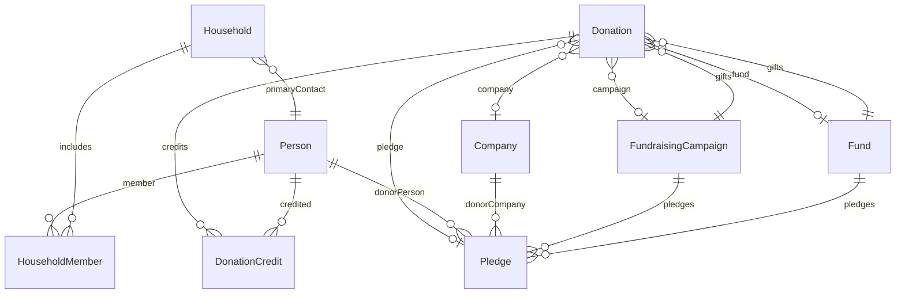

# Streetlight CRM — NPSP-Inspired Donor Schema

This document defines the Streetlight CRM nonprofit donor data model. It mirrors common **Salesforce NPSP** (Nonprofit Success Pack) patterns—Accounts/Households, Opportunities (gifts), Opportunity Contact Roles (soft/hard credit), Campaigns, Recurring Donations/Pledges, and General Accounting Units (Funds)—mapped onto Twenty’s **Person**, **Company**, and custom objects.

## Design principles

| NPSP concept | Twenty mapping |
|--------------|----------------|
| Contact | **Person** (standard) |
| Organization / Account | **Company** (standard) |
| Household Account | **Household** (custom) |
| Household Member | **Household Member** (junction) |
| Opportunity (gift) | **Donation** (custom) |
| Opportunity Contact Role (OCR) | **Donation Credit** (custom junction) |
| General Accounting Unit (GAU) | **Fund** (custom) |
| Campaign | **Fundraising Campaign** (custom; not Message Campaign) |
| Recurring Donation / Pledge | **Pledge** (custom) |

Rollups on Person (`lifetimeHardGiving`, `lifetimeSoftGiving`, gift dates) follow NPSP-style donor statistics. Household-level giving rollups support joint acknowledgment and statement logic.

## Standard objects (extended)

### Person (`person`)

Built-in Twenty object. Streetlight extensions are installed by the donor-operations app.

| Field API name | Label | Type | NPSP analog | Notes |
|----------------|-------|------|-------------|-------|
| `lifetimeHardGiving` | Lifetime Hard Giving | Currency | Contact soft/hard rollup (hard) | Sum of hard credits |
| `lifetimeSoftGiving` | Lifetime Soft Giving | Currency | Soft credit rollup | Sum of soft credits |
| `firstGiftDate` | First Gift Date | Date | First Gift Date | Earliest hard-credit gift |
| `lastGiftDate` | Last Gift Date | Date | Last Gift Date | Most recent hard-credit gift |
| `donorType` | Donor Type | Select | Donor level / segment | Major, Annual, Monthly, Lapsed, Prospect, Board |
| `preferredAcknowledgment` | Preferred Acknowledgment | Select | Ack preference | Email, Mail, Phone, None |
| `doNotSolicit` | Do Not Solicit | Boolean | Do Not Contact (solicit) | Suppress asks |
| `externalDonorId` | External Donor ID | Text | External ID | Legacy CRM / processor key |

### Company (`company`)

Built-in object. Standard ID: `a5fdd822-52e5-4f8a-8832-811bc1906062`.

Used as organizational donor on **Donation** and **Pledge**. No custom fields in initial provision; extend as needed (`orgType`, `externalOrgId`, etc.).

---

## Custom objects

### Household (`household`)

NPSP **Household Account**. May already exist in workspace (`135b11b6-7178-436c-aa2d-8f13bc9f8d3f`) with **Primary Contact** relation to Person.

| Field API name | Label | Type | Notes |
|----------------|-------|------|-------|
| `name` | Name | Text | System name field (default) |
| `primaryContact` | Primary Contact | Relation → Person | May exist before provision |
| `formalSalutation` | Formal Salutation | Text | e.g. “Mr. & Mrs. Lane” for mail merge |
| `mailingAddress` | Mailing Address | Address | Household-level mailing |
| `lifetimeHardGiving` | Lifetime Hard Giving | Currency | Household rollup (hard) |

**Inverse relations:** Household Members (from junction), notes/tasks as configured in Twenty.

### Household Member (`householdMember`)

NPSP **Contact ↔ Household** junction (Household Contact roles).

| Field API name | Label | Type | Notes |
|----------------|-------|------|-------|
| `household` | Household | M2O → Household | Required for membership |
| `person` | Person | M2O → Person | Member contact |
| `memberRole` | Role | Select | Head, Spouse, Child, Other |
| *(note)* | | | | API name `memberRole` — `role` is reserved in Twenty metadata |
| `isActive` | Is Active | Boolean | Current vs historical member |
| `receiveHouseholdSoftCredit` | Receive Household Soft Credit | Boolean | NPSP-style household soft credit flag |

### Donation (`donation`)

NPSP **Opportunity** (closed/won gift).

| Field API name | Label | Type | Notes |
|----------------|-------|------|-------|
| `amount` | Amount | Currency | Gift amount |
| `giftDate` | Gift Date | Date | Date of gift (Close Date analog) |
| `depositDate` | Deposit Date | Date | Bank deposit / batch date |
| `paymentMethod` | Payment Method | Select | Check, Credit Card, ACH, Wire, Stock, Cash, In-Kind, Other |
| `checkNumber` | Check Number | Text | |
| `externalTransactionId` | External Transaction ID | Text | Idempotency for imports / Stripe / PayPal |
| `goodsOrServicesProvided` | Goods or Services Provided | Boolean | Tax / acknowledgment rules |
| `goodsOrServicesValue` | Goods or Services Value | Currency | FMV if applicable |
| `processingFee` | Processing Fee | Currency | Added on live workspace; processor fees |
| `inKindDescription` | In-Kind Description | Text | What was donated for IN_KIND gifts (Daily Giving app field) |
| `acknowledgmentStatus` | Acknowledgment Status | Select | Pending, Sent, Do Not Acknowledge |
| `tributeType` | Tribute Type | Select | In Memory, In Honor, None |
| `tributeName` | Tribute Name | Text | |
| `statementIncluded` | Statement Included | Boolean | Annual statement inclusion |
| `company` | Company | M2O → Company | Org donor (if not Person OCR) |
| `fundraisingCampaign` | Fundraising Campaign | M2O → Fundraising Campaign | Campaign attribution |
| `fund` | Fund | M2O → Fund | GAU / designation |
| `pledge` | Pledge | M2O → Pledge | Link fulfillment to commitment |

**Donor identity:** Individual donors are typically represented via **Donation Credit** (hard credit on Person) rather than a direct Person relation on Donation, matching NPSP OCR patterns.

### Donation Credit (`donationCredit`)

NPSP **Opportunity Contact Role** — allocates hard or soft credit to contacts for a gift.

| Field API name | Label | Type | Notes |
|----------------|-------|------|-------|
| `donation` | Donation | M2O → Donation | Parent gift |
| `person` | Person | M2O → Person | Credited contact |
| `creditType` | Credit Type | Select | Hard, Soft |
| `creditRole` | Credit Role | Select | Donor, Soft Credit, Matching Gift, Tribute Honoree, Household Member |
| `creditAmount` | Credit Amount | Currency | Portion of gift amount |
| `includeInStatement` | Include In Statement | Boolean | |
| `thanked` | Thanked | Boolean | Acknowledgment tracking per role |

### Fund (`fund`)

NPSP **General Accounting Unit (GAU)**.

| Field API name | Label | Type | Notes |
|----------------|-------|------|-------|
| `name` | Name | Text | System name field |
| `fundCode` | Fund Code | Text | GL / external code |
| `isRestricted` | Is Restricted | Boolean | |
| `restrictionType` | Restriction Type | Select | Program, Capital, Endowment, General, Unrestricted, Other |
| `isActive` | Is Active | Boolean | |

### Fundraising Campaign (`fundraisingCampaign`)

NPSP **Campaign** (fundraising appeal). Distinct from Twenty’s messaging **Campaign** objects.

| Field API name | Label | Type | Notes |
|----------------|-------|------|-------|
| `name` | Name | Text | System name field |
| `goalAmount` | Goal Amount | Currency | |
| `startDate` | Start Date | Date | |
| `endDate` | End Date | Date | |
| `status` | Status | Select | Planned, Active, Completed, Cancelled |

### Pledge (`pledge`)

NPSP **Recurring Donation** / pledge schedule (simplified).

| Field API name | Label | Type | Notes |
|----------------|-------|------|-------|
| `name` | Name | Text | System name field |
| `totalAmount` | Total Amount | Currency | Commitment total |
| `balance` | Balance | Currency | Remaining balance |
| `startDate` | Start Date | Date | |
| `endDate` | End Date | Date | |
| `frequency` | Frequency | Select | Monthly, Quarterly, Semi-Annual, Annual, One-Time |
| `status` | Status | Select | Active, Fulfilled, Cancelled, Delinquent |
| `donorPerson` | Donor (Person) | M2O → Person | |
| `donorCompany` | Donor (Company) | M2O → Company | |
| `fundraisingCampaign` | Fundraising Campaign | M2O → Fundraising Campaign | |
| `fund` | Fund | M2O → Fund | Default designation |

---

## Relationship diagram

---

## Metadata API provisioning

Programmatic provisioning: `scripts/provision-schema.py`

- **Endpoint:** `POST ${TWENTY_API_URL}/metadata` (GraphQL)
- **Auth:** `Authorization: Bearer ${TWENTY_API_KEY}`
- **Idempotency:** Lists existing objects/fields; skips by API name
- **Relations:** `relationCreationPayload` with `MANY_TO_ONE`, `targetObjectMetadataId`, `targetFieldLabel`, `targetFieldIcon`
- **Select options:** JSON array `{ value, label, position, color }` — `value` must be `UPPER_SNAKE_CASE`; `label` is the human-readable display string

---

## Integration notes

1. Set `externalTransactionId` on every imported **Donation** for idempotent payment sync.
2. Set `externalDonorId` on **Person** for legacy CRM matching.
3. Use **Donation Credit** for household soft credits and matching gifts, not duplicate Donation rows.
4. Recalculate Person/Household rollups via workflow or ETL after bulk import (Twenty does not auto-roll up like NPSP without automation).

---

## Revision history

| Date | Change |
|------|--------|
| 2026-08-25 | Documented live `processingFee` field and app-provisioned `inKindDescription` (Daily Giving) |
| 2026-06-17 | Initial NPSP-inspired donor schema and provision script |
